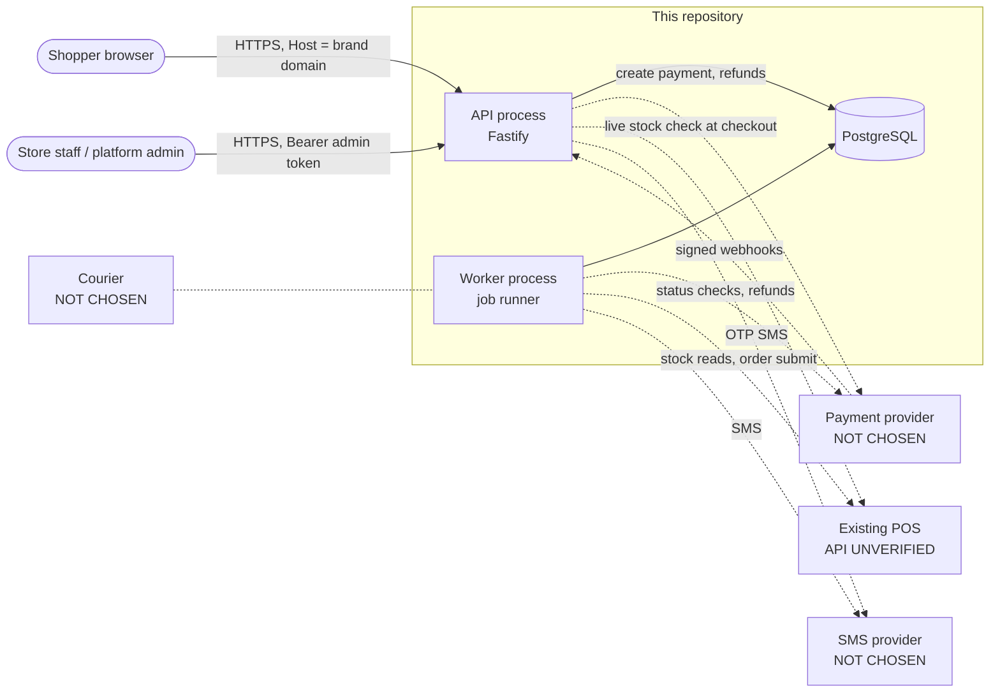
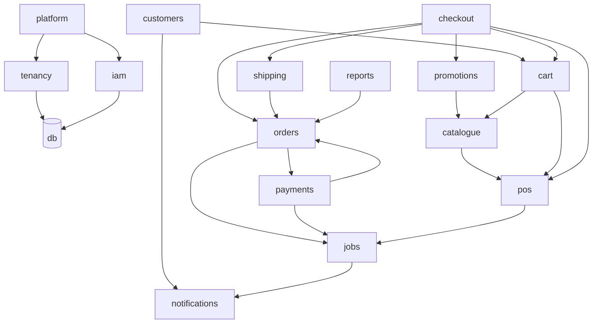
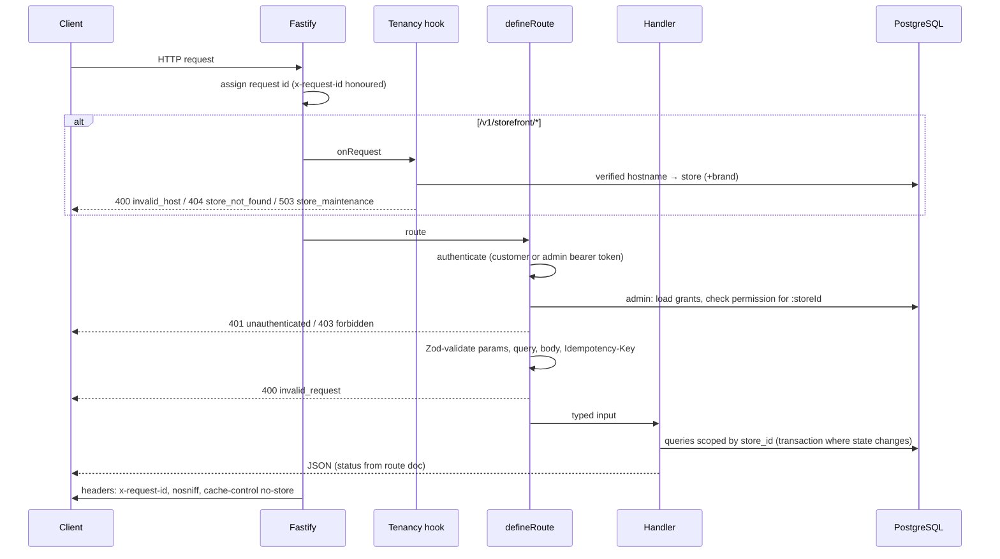
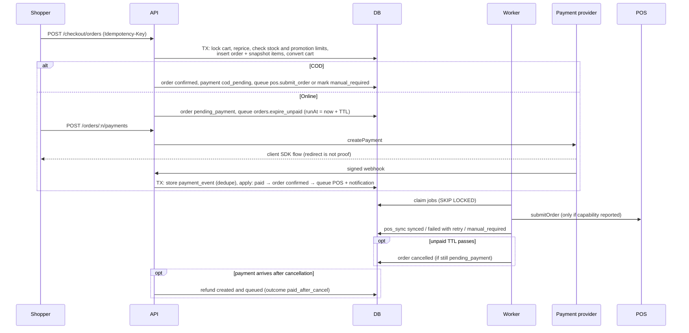
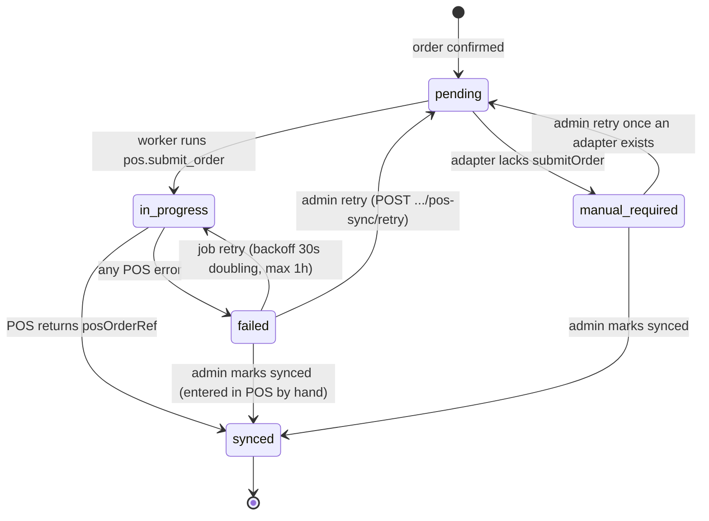
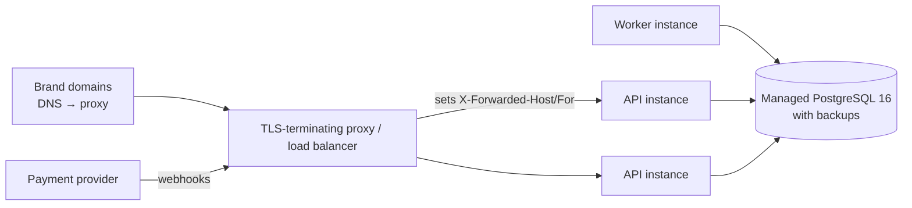

# Architecture

Status: describes the code on branch `claude/project-thread-4t2912`. Nothing is deployed. Diagrams marked **proposed** describe intent, not something that exists.

## Summary

- **Shape:** a modular monolith. There is one TypeScript codebase (`apps/api`) with two processes:
  - the HTTP API (`src/server.ts`);
  - a background worker (`src/worker.ts`).
- **Shared state:** both processes share one PostgreSQL 16 database.
- **Modules:** each business area is a folder under `apps/api/src/modules/`.
- **External systems:** each is reached through a port (an interface). The implementations are either test doubles or "not configured" stubs:
  - POS: `PosGateway`.
  - Payments: `PaymentProvider`.
  - SMS: `MessageSender`.
  - Courier: `CourierAdapter`.

Why a monolith: one team and one database, and checkout needs order, payment, promotion and stock changes in a single transaction. See [DECISIONS.md](DECISIONS.md) ADR-001.

## System context

Dotted lines are ports with no live adapter. Today:
- POS calls go to `UnconfiguredPosGateway`, which reports no capabilities.
- Payments use `FakePaymentProvider` (only when `PAYMENT_PROVIDER=fake`, and never in production) or nothing.
- SMS goes to `LogMessageSender`, which logs a masked recipient and the template name only, or to `DisabledMessageSender`.

## Modules and ownership

| Module | Owns (tables) | Depends on |
| --- | --- | --- |
| `tenancy` | resolves the store per request; `store_domains` lookups | db |
| `platform` | `brands`, `stores`, `store_domains`, store settings, `audit_logs` reads | iam, tenancy |
| `iam` | `admin_users`, `admin_role_assignments`, `admin_sessions`; roles and permissions in code | db |
| `customers` | `customers`, `customer_sessions`, `otp_challenges`, `customer_addresses` | notifications, cart (merge on login) |
| `catalogue` | `attribute_definitions`, `categories`, `size_charts`, `products`, `product_variants`, `product_categories`, `collections`, `collection_products`, `product_media`, `variant_prices`, `price_history` | pos (stock read model for availability) |
| `promotions` | `promotions`, `coupons`, `promotion_redemptions` | catalogue (eligibility) |
| `cart` | `carts`, `cart_items` | catalogue, pos stock |
| `checkout` | creates `orders`, `order_items` | cart, promotions, shipping, pos, orders, jobs |
| `orders` | `orders` state, `order_events`, `return_requests`, `store_counters` | payments (refunds), jobs, pos |
| `payments` | `payment_transactions`, `payment_events`, `refunds` | orders |
| `shipping` | `shipping_zones`, `shipments`, `shipment_events` | orders |
| `pos` | `pos_stock_levels` (read model only) | PosGateway port |
| `jobs` | `jobs` | every module that queues work |
| `content` | `content_pages`, `content_blocks` | none |
| `notifications` | message sending port | none |
| `reports` | read-only queries over orders | orders |

There is no `pricing` module code yet. Price endpoints live in `catalogue/admin-routes.ts`, and the empty `src/modules/pricing/` folder is left over from the foundation.

### Module dependencies

`orders` and `payments` depend on each other through function calls in the same transaction:
- A payment success confirms the order.
- A cancellation creates a refund.

This is deliberate. Splitting them would require a distributed transaction.

## Request lifecycle

Code: `src/app.ts` (wiring, headers, request ids), `src/modules/tenancy/resolve-store.ts`, `src/lib/route.ts` (`defineRoute`), `src/lib/errors.ts`.

Admin routes never use the Host header. The store comes from the `:storeId` path parameter, and `defineRoute` checks the caller's permission for that specific store before the handler runs. Every admin handler then queries with `store_id = :storeId`.

## Order and payment lifecycle

Detail, including all state machines: [ORDERS_AND_FULFILLMENT.md](ORDERS_AND_FULFILLMENT.md) and [PAYMENTS.md](PAYMENTS.md).

## POS sync and retry lifecycle

Stock follows a separate path:
- `pos.sync_stock` jobs refresh the `pos_stock_levels` read model.
- Checkout makes a live `getStock` call when the adapter supports it.
- If stock is unknown, the item cannot be sold. See [POS_INTEGRATION.md](POS_INTEGRATION.md).

## Deployment topology (proposed, not verified)

Nothing has been deployed and no hosting has been chosen. This is the shape the code is built for. See [DEPLOYMENT.md](DEPLOYMENT.md).

Verified: the Docker image builds from `apps/api/Dockerfile`, and CI runs typecheck, tests, build and an OpenAPI drift check (`.github/workflows/ci.yml`). Everything else in this diagram is a proposal.

## Cross-cutting rules

- **Data ownership.** The POS owns SKU identity and stock. E-commerce stores `sku_code` only as a reference (`product_variants.sku_code`, unique per store) and keeps a stock *read model*, never a ledger. E-commerce owns prices, promotions, carts, orders, payments, shipments, returns and content.
- **Communication.** Modules call each other's functions inside one process. External systems are reached through ports only. Asynchronous work goes through the `jobs` table. There is no message broker.
- **Transactions.** Every state change that spans tables runs in one database transaction. Rows are locked `FOR UPDATE` where concurrency matters: carts at checkout, orders on transitions, payment transactions on webhooks, and promotions when checking limits. Jobs are enqueued inside the same transaction, so they exist only if the change commits.
- **Idempotency.**
  - Checkout: `Idempotency-Key` header, unique per customer, with a request hash to detect a reused key on a different body.
  - Refunds: an idempotency key per refund.
  - Webhooks: unique `(provider, provider_event_id)`.
  - Jobs: unique `idempotency_key`.
  - Notifications: deduplicated by template and order.
- **Async work.** Durable jobs live in PostgreSQL. Workers claim them with `FOR UPDATE SKIP LOCKED` and retry with exponential backoff. A job whose worker died is recovered after 15 minutes. Jobs that cannot succeed go to `dead`, where admins can see and retry them. See [OPERATIONS.md](OPERATIONS.md).
- **Tenant isolation.**
  - Storefront requests resolve the store from a verified host.
  - Admin requests are authorized per store.
  - Every store-owned table has `store_id`.
  - Child tables reference parents through composite foreign keys `(store_id, id)`, so a row cannot point at another store's data even through a bug. See [TENANCY.md](TENANCY.md).
- **Failure recovery.**
  - POS failures leave the order confirmed and the sync retryable or manual.
  - Payment webhooks are replay-safe, and the reconciliation job asks the provider about stale pending payments.
  - Unpaid orders expire.
  - Dead jobs can be retried from the admin API.
- **Money.** All amounts are integers in paise. Prices are GST-inclusive. Included tax is derived per line as `round(amount × rate / (10000 + rate))`, with the rate in basis points.

## Implemented vs planned

| Area | State |
| --- | --- |
| API process, worker, database schema, all modules above | Implemented |
| Real POS adapter | Blocked: POS API unverified |
| Real payment, SMS and courier adapters | Blocked: providers not chosen or approved |
| Storefront and admin UIs | Planned |
| Scheduled recurring jobs (stock sync, reconciliation) | Planned: these jobs exist but are only queued from admin endpoints today |
| Shared rate limiting across instances | Planned: login limits are in-process |
| Hosting, TLS, backups, monitoring | Planned |
