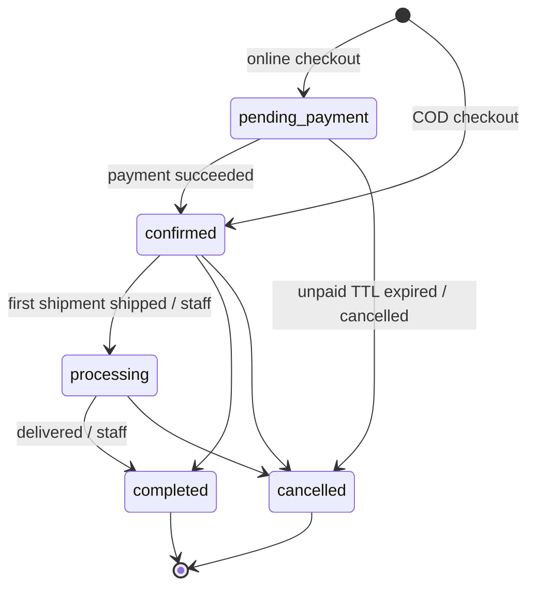
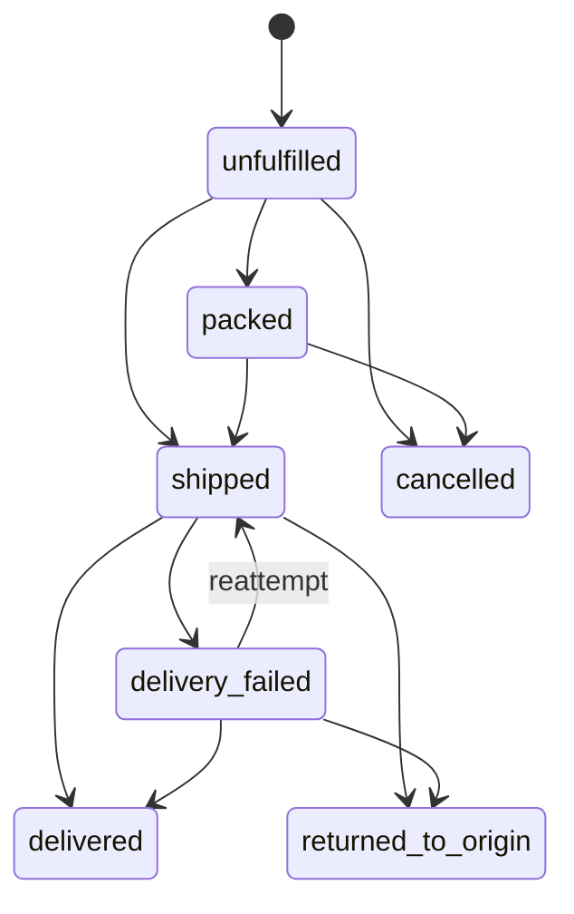
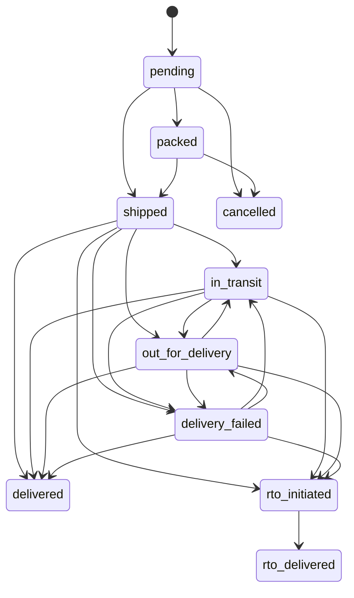
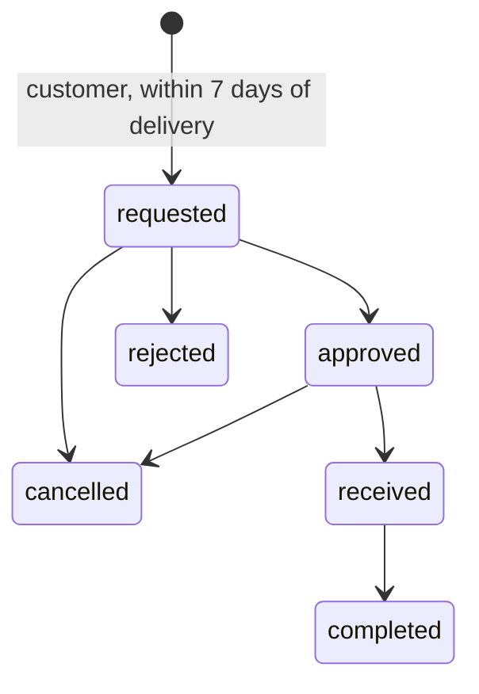

# Orders and fulfillment

Status: **implemented**. Shipments and tracking events are entered by staff, because there is no courier integration yet. Code: `apps/api/src/modules/{cart,checkout,orders,promotions,shipping}`. Tests: `apps/api/test/commerce.test.ts` and `unit.test.ts`.

## Cart

- **Guest carts:** `POST /v1/storefront/cart` returns a `cartToken` once. Only its hash is stored. The client sends it back in `x-cart-token`.
- **Customer carts:** each customer has at most one active cart (partial unique index). When a shopper signs in with OTP or password and sends `x-cart-token`, the guest cart merges into their cart. Quantities add up, capped at 100 per line, and the guest cart becomes `merged`.
- **Lines:** cart lines store only the variant and quantity. Every cart read is repriced from current data, and lines that are unavailable or short of stock are reported in `issues`.
- **Coupons:** a cart holds at most one coupon code. It is re-validated on every quote.

## Quote (server-side pricing)

`buildQuote` (`checkout/quote.ts`) computes everything from the database. Nothing is taken from the client:

1. Each line's unit price comes from `variant_prices`. Products must be `published` and variants `active`.
2. Stock comes from `pos_stock_levels`, refreshed live first at checkout when the POS supports it. If there is no stock row, the line gets `stock_unknown` and cannot be bought.
3. Promotions are applied by the engine (see [Promotions](#promotions)).
4. Shipping comes from the zone matching the delivery PIN, longest prefix first. The zone sets a charge, an optional free-above threshold, COD availability and a COD fee. If no zone matches, the quote reports `not_serviceable`. Free-shipping promotions remove the charge.
5. Tax: prices include GST. Each line's included tax is `round(lineTotal × rate / (10000 + rate))`, using the product's `tax_rate_bps`.
6. If COD is chosen, the COD fee is added and COD eligibility is checked.

## Checkout

`POST /v1/storefront/checkout/orders` requires a signed-in customer, an `Idempotency-Key`, an address id and a payment method. `expectedTotalPaise` is optional. In one transaction it:

1. Locks the customer's active cart. An already-converted cart returns `409`.
2. Refreshes stock live where possible, then rebuilds the quote. If the quote has issues, it returns `409 conflict` with `details.issues`.
3. If `expectedTotalPaise` is given and differs from the server total, it returns `409 price_changed` with the new quote.
4. Locks the applied promotions and re-checks usage limits (total, per customer and per coupon). If a promotion has run out, it returns `409 price_changed`.
5. Allocates the order number from `store_counters`, formatted `PREFIX-000123`.
6. Inserts the order, with immutable snapshots of the customer, shipping address and applied promotions, and one `order_items` row per line with its title, SKU, MRP, price, discount, tax and image.
7. Records promotion redemptions, converts the cart and adds the first timeline event.
8. **COD:** the order is `confirmed` with payment `cod_pending`. POS sync is scheduled and a confirmation notification is queued.
   **Online:** the order is `pending_payment`, and `orders.expire_unpaid` is queued.

If the request is replayed with the same key, the original order comes back with status 200. If the same key is used with a different body, the response is `422 idempotency_key_reused`.

## State machines

Each order carries **four independent statuses**: `status`, `payment_status`, `fulfillment_status` and `pos_sync_status`. Returns, refunds, shipments and payment transactions have their own machines. All transitions are listed in `MACHINES` (`orders/state-machines.ts`). Every change goes through `transitionOrder`, which checks the transition is legal (otherwise `409 invalid_transition`) and writes an `order_events` row with the actor, the from and to states, and a note. Events marked `is_public` appear on the customer's timeline.

### Order

### Fulfillment

Fulfillment status follows shipment events:

| Shipment status | Fulfillment status |
| --- | --- |
| `packed` | `packed` |
| `shipped`, `in_transit`, `out_for_delivery` | `shipped` |
| `delivered` | `delivered` |
| `delivery_failed` | `delivery_failed` |
| `rto_delivered` | `returned_to_origin` |

When fulfillment becomes `shipped`, a `confirmed` order moves to `processing`. When it becomes `delivered`, the order moves to `completed`. Both changes queue notifications.

### Shipment

Tracking events are posted to `POST /v1/admin/stores/:storeId/shipments/:id/events`:
- An optional `externalEventId` makes them idempotent. A duplicate returns `applied: false, reason: "duplicate"`.
- An event older than the newest one already recorded is stored for history but does not change status (`reason: "out_of_order"`).
- An illegal transition is stored but not applied (`reason: "invalid_transition"`).

The same rules will apply to courier webhooks once a courier is integrated.

### Payment, transaction and refund

See [PAYMENTS.md](PAYMENTS.md#payment-state-machines).

### POS sync

See [POS_INTEGRATION.md](POS_INTEGRATION.md#order-submission-and-retries) and the diagram in [ARCHITECTURE.md](ARCHITECTURE.md#pos-sync-and-retry-lifecycle).

### Returns and exchanges

- Customers request returns with `POST /v1/storefront/orders/:orderNumber/returns`. The type is `return` or `exchange`. They choose items and quantities, and for an exchange the variant they want instead. The 7-day window starts at the order's `delivered` timeline event. It is hard-coded as `RETURN_WINDOW_DAYS` in `orders/storefront-routes.ts`.
- Staff move a return through its states with `POST /v1/admin/stores/:storeId/returns/:id/status`. Each change queues a notification (`return.<status>`).
- A refund for a return is a separate refund linked by `returnRequestId`.
- An exchange's replacement is shipped by staff. Automatic replacement orders are not built (see [KNOWN_ISSUES.md](KNOWN_ISSUES.md)).

## Cancellation

- **Customers** can cancel their own order (`POST /v1/storefront/orders/:orderNumber/cancel`).
- **Staff** use `POST /v1/admin/stores/:storeId/orders/:id/cancel`.
- Either way, cancellation is allowed only while fulfillment is `unfulfilled` or `packed`.
- `cancelOrder` then:
  - sets the order and fulfillment to `cancelled`;
  - voids the promotion redemptions, so usage limits are released;
  - creates a full refund if the order was paid online;
  - queues `pos.cancel_order` if the order reached the POS and the adapter supports cancellation;
  - queues a notification.
- **Unpaid online orders** are cancelled automatically by `orders.expire_unpaid` once `unpaidOrderTtlMinutes` passes, if they are still `pending_payment`.

## Promotions

Engine: `modules/promotions/engine.ts` (pure functions). Loading and limits: `loader.ts`. Admin: `admin-routes.ts`.

**Kinds**
- `percentage`: `percentBps` (1–10000), with an optional `maxDiscountPaise` cap.
- `fixed_amount`: `amountPaise` off the eligible lines, spread in proportion to line value.
- `buy_x_get_y`: for every `buyQuantity + getQuantity` eligible units, the cheapest `getQuantity` units get `getDiscountBps` off. Units are sorted most expensive first. `getDiscountBps` = 10000 makes them free.
- `free_shipping`: removes the shipping charge (not the COD fee).

**Eligibility and limits**
- `eligibility` lists product ids and/or collection ids. Empty means every product.
- `minSubtotalPaise` is a threshold on the eligible lines' **pre-discount** subtotal.
- `starts_at` / `ends_at` set the validity window. `status` must be `active`.
- `requires_coupon` means the promotion applies only with one of its coupons. Coupon codes are upper-cased and unique per store, and each coupon can have its own usage limit.
- `usage_limit` (total) and `per_customer_limit` count redemptions. Voided redemptions from cancelled orders do not count. The limits are checked when quoting and again under lock at checkout.

**Stacking rules** (as implemented)
1. Promotions run in `priority` order, highest first. Ties are broken by id, so the result is deterministic.
2. A **non-stackable** promotion applies only if nothing has applied yet, and once it applies, nothing else does. Stackable promotions combine with each other.
3. Each promotion discounts what is left of a line after earlier promotions, so a line never goes below zero.
4. Thresholds use the pre-discount subtotal of the eligible lines.
5. A promotion that would discount nothing is not reported as applied.

Applied promotions, with their amounts and coupon codes, are snapshotted on the order (`applied_promotions`) and recorded in `promotion_redemptions`.

## Shipping

- **Zones** (`shipping_zones`) per store: PIN prefixes (longest match wins), charge, an optional free-above amount, COD availability and fee, and estimated delivery days. Manage them with `/v1/admin/stores/:storeId/shipping-zones` (`shipping.write`). Shoppers check a PIN with `GET /v1/storefront/shipping/serviceability?pincode=`.
- **Shipments:** created by staff (`POST .../orders/:id/shipments`) with courier name and tracking number. The pair `(courier, tracking_number)` is unique.
- **Courier adapters:** `CourierAdapter` in `shipping/courier.ts` is a port only. No courier has been chosen, so no courier API is called.
