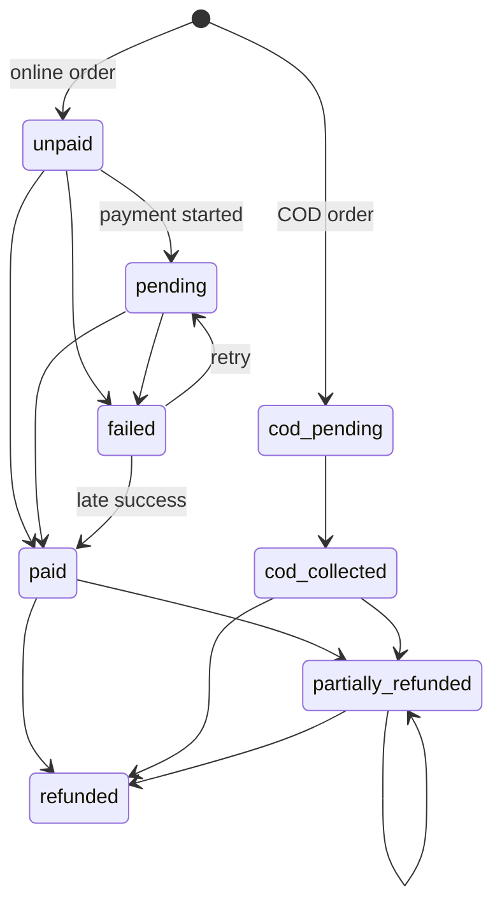

# Payments

Status:
- **Provider-neutral design, webhook processing, refunds, COD and reconciliation:** implemented and tested with a **fake provider**.
- **Paytm adapter:** **partial**. Built and tested against a simulated Paytm API, with per-store credentials set by admins. It has **not** yet been run against Paytm staging, because no test MID or key was available. See [Paytm](#paytm).
- **Live payments:** off. Production Paytm is refused unless the deployment sets `PAYTM_PRODUCTION_ENABLED=true`, which needs the owner's approval.

Code: `apps/api/src/modules/payments/`. Tests: `apps/api/test/payments.test.ts`.

## Provider interface

`PaymentProvider` (`provider.ts`) has four operations:
- `createPayment({transactionId, orderNumber, amountPaise, currency})` returns a `providerRef` and a `clientPayload` for the provider's browser SDK.
- `parseWebhook(rawBody, headers)` verifies the signature over the **raw** body and returns a normalised event: `payment.succeeded`, `payment.failed`, `refund.succeeded` or `refund.failed`. It throws `WebhookVerificationError` when the signature does not match.
- `fetchPaymentStatus(providerRef)` is a server-side status check used by reconciliation.
- `createRefund({refundId, paymentRef, amountPaise})` returns a `refundRef`.

A real adapter (Razorpay, Cashfree, PayU or another) must be written against that provider's documented contract, in its own file. It is then registered in `createContext` (`src/app.ts`) and enabled by a new `PAYMENT_PROVIDER` value.

`FakePaymentProvider` (`fake-provider.ts`) signs webhooks with HMAC-SHA256 in `x-fake-signature`, using `FAKE_PAYMENT_WEBHOOK_SECRET`. It moves no money. Configuration validation refuses `PAYMENT_PROVIDER=fake` in production.

## Paytm

Code: `apps/api/src/modules/payments/paytm/`. Tests: `apps/api/test/paytm.test.ts`.

### Credentials per store (admin)

Nothing is hard-coded. Each store's admin sets its own Paytm details:

- `GET /v1/admin/stores/:storeId/payment-gateways/paytm` returns the settings, with `merchantKeySet: true` instead of the key.
- `PUT /v1/admin/stores/:storeId/payment-gateways/paytm` takes `merchantId`, `merchantKey` (16 characters, write-only), `websiteName` (default `WEBSTAGING`), `callbackUrl` (https), `environment` (`staging` or `production`) and `enabled`. Leave `merchantKey` out to keep the stored key.

Both need `store.settings.manage` for that store. The key is encrypted with AES-256-GCM using `CONFIG_ENCRYPTION_KEY` before it is stored in `payment_gateway_configs`. It is never returned, logged or written to the audit log; the audit row records only `merchantKeyChanged`.

When a store has Paytm enabled, its online payments use Paytm. Otherwise they use the deployment-wide `PAYMENT_PROVIDER`.

### Flow (Paytm JS Checkout)

1. `POST /v1/storefront/orders/:orderNumber/payments` calls Paytm **Initiate Transaction** (`/theia/api/v1/initiateTransaction`) with the store's MID. Paytm's `orderId` is our payment transaction id. The response gives the browser `mid`, `orderId`, `txnToken`, `amount` and the checkout script URL. No secrets are included.
2. The shopper pays in Paytm's checkout. The browser callback to `callbackUrl` is **not** proof of payment.
3. Paytm posts a form-encoded notification to `POST /v1/webhooks/payments/paytm`. The handler:
   - finds the store from `ORDERID`;
   - checks that `MID` matches that store;
   - verifies `CHECKSUMHASH` with that store's key.

   Anything else is rejected with `400 webhook_invalid`. `TXN_SUCCESS` and `TXN_FAILURE` go through the normal event path. The amount is checked, and duplicates are dropped by `TXNID:STATUS`. `PENDING` changes nothing.
4. **Reconciliation** uses Paytm **Order Status** (`/v3/order/status`).
5. **Refunds** read Paytm's `txnId` from Order Status, then call **Refund Apply** (`/refund/apply`) with our refund id as `refId`.

Requests are signed like Paytm's PaytmChecksum library: AES-128-CBC over `sha256(payload|salt)+salt`, in `checksum.ts`.

### Not verified yet

Everything above was written from Paytm's published API documentation and tested only against a simulated Paytm API. Before the first staging payment, confirm:

- the hosts: `PAYTM_STAGING_HOST` defaults to `https://securestage.paytmpayments.com`;
- the endpoint paths and response fields;
- that the checksum matches Paytm's;
- the notification field names.

Also not built yet:

- verifying the signature on Paytm's API *responses*;
- a refund-status webhook or poll. Refunds stay `processing` after Paytm accepts them; see [KNOWN_ISSUES.md](KNOWN_ISSUES.md).

## Online payment flow

1. Checkout creates the order as `pending_payment` with payment status `unpaid`. It also queues `orders.expire_unpaid` to run after `stores.config.unpaidOrderTtlMinutes` (default 30).
2. `POST /v1/storefront/orders/:orderNumber/payments` creates a `payment_transactions` row (`created`) and calls `createPayment` outside the transaction.
   - On success, the transaction becomes `pending` and the order payment status becomes `pending`.
   - On failure, the transaction becomes `failed` and the call returns `502 payment_error`.
3. The shopper pays in the provider's UI. **The browser redirect or callback is never treated as proof of payment.**
4. The provider calls `POST /v1/webhooks/payments/:provider`, and the webhook decides the outcome.
5. A shopper can retry payment after a failure (`failed → pending`). Each attempt creates a new transaction.

## Webhook processing

`webhook-routes.ts` and `ingestPaymentEvent` in `service.ts` handle each delivery:

1. The raw body is read (at most 256 KB). An unknown provider returns `404`. A bad signature returns `400 webhook_invalid`, and nothing is stored.
2. In one transaction:
   - The event is inserted into `payment_events`. If `(provider, provider_event_id)` already exists, the result is `duplicate` and processing stops.
   - The event is applied, with the payment transaction row and then the order row locked.
   - The event row is stamped with `processed_at` and the outcome.
3. The response is `200 {"received": true, "outcome": ...}`, so the provider stops retrying. Only unexpected errors return 5xx, and the provider then retries.

| Outcome | When | Effect |
| --- | --- | --- |
| `applied` | Normal success or failure | Success: transaction `succeeded`, order payment `paid`, order `pending_payment → confirmed`, POS sync scheduled, confirmation notification queued. Failure: transaction and order payment become `failed` |
| `duplicate` | Same provider event id again | None |
| `ignored_stale` | Out of order, for example a failure arriving after a success | None. A late **success** after a failure *is* applied, because the provider is the source of truth |
| `amount_mismatch` | Reported amount differs from the transaction amount | Not applied. Order timeline note for staff |
| `unknown_reference` | No transaction with that provider reference | Stored for investigation |
| `paid_after_cancel` | Success arrives after the unpaid order expired or was cancelled | Payment recorded, and a **full refund is created and queued automatically** |
| `duplicate_payment` | A second successful transaction for an order that is already paid | Not applied. The transaction is flagged `duplicate_payment` and a timeline note asks staff to refund it from the provider dashboard (see [KNOWN_ISSUES.md](KNOWN_ISSUES.md)) |

The database also guarantees at most one `succeeded` transaction per order (`payment_transactions_one_success_uq`).

## Cash on delivery

- COD is offered when the store enables it (`config.codEnabled`), the order total is within `config.codMaxOrderPaise`, and the delivery PIN's shipping zone allows COD (`shipping_zones.cod_available`, with an optional COD fee). Otherwise the quote reports `cod_unavailable`.
- A COD order is confirmed at checkout with payment status `cod_pending`, and POS sync is scheduled immediately.
- Staff record collection with `POST /v1/admin/stores/:storeId/orders/:id/cod-collected`. This writes a `cod` transaction and sets the order to `cod_collected`.

## Refunds

- `POST /v1/admin/stores/:storeId/orders/:id/refunds` (`refunds.manage`) requires an `Idempotency-Key`. The amount must be at most the collected total, minus refunds already made, minus refunds in flight. Otherwise it returns `422 invalid_request` with `refundablePaise`. Refunds can be linked to a return request.
- **Online refunds** are created `pending`, and `payments.process_refund` sends them to the provider (`processing`). A `refund.succeeded` or `refund.failed` webhook finishes them.
- **COD refunds**, paid by bank transfer or cash, are recorded with `POST /v1/admin/stores/:storeId/refunds/:id/mark-succeeded`, with a reference. This endpoint refuses online refunds, because the provider must confirm those.
- On success, `orders.refunded_paise` increases and payment status becomes `partially_refunded` or `refunded`. A notification is queued.
- Cancelling a paid order creates a full refund automatically (idempotency key `cancel:<orderId>`).

## Reconciliation

The `payments.reconcile` job finds transactions still `pending` more than 15 minutes after creation (up to 100 per run). It asks the provider for their status with `fetchPaymentStatus` and feeds the answer through the **same** event path, with event id `reconcile:<txnId>:<status>`. So a lost webhook cannot leave an order stuck, and a later real webhook becomes `ignored_stale` or `duplicate`.

Today the job is queued by `POST /v1/admin/stores/:storeId/payments/reconcile`. Scheduling it periodically is planned ([IMPLEMENTATION_PLAN.md](IMPLEMENTATION_PLAN.md)).

## Payment state machines

Order payment status (`MACHINES.payment`):

Transaction (`MACHINES.transaction`): `created → pending | succeeded | failed | cancelled`; `pending → succeeded | failed | cancelled`; `failed → succeeded`.

Refund (`MACHINES.refund`): `pending → processing | succeeded | failed`; `processing → succeeded | failed`; `failed → processing | succeeded`.

Related: [ORDERS_AND_FULFILLMENT.md](ORDERS_AND_FULFILLMENT.md), [SECURITY.md](SECURITY.md#webhooks-and-payments).
