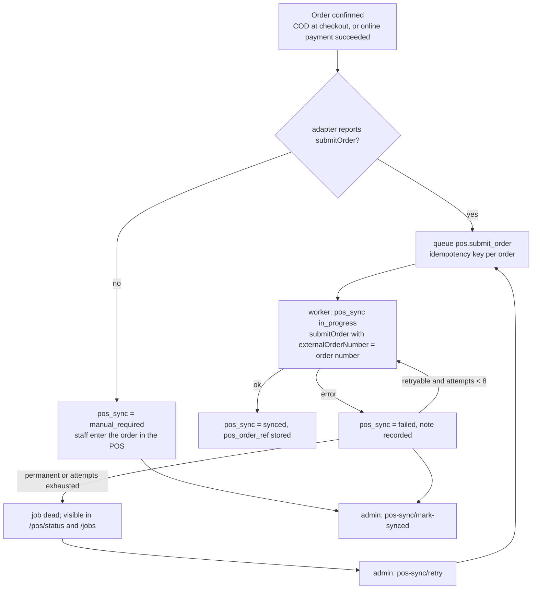

# POS integration

Status:
- **Port, jobs, read model, recovery tools and test double:** implemented.
- **Real POS adapter:** **blocked**. The POS API has not been inspected, and nothing about it is verified.

## What is verified

Nothing about the POS itself.
- The POS backend is not in any GitHub repository this project can reach ([phase-0-discovery.md](phase-0-discovery.md)).
- The brief names two server paths, `/opt/tazeen-pos/offers-pos/backend` and `/opt/tazeen-pos/backend`. Neither has been inspected.
- Read-only access to the POS server through a session on the user's device was offered and declined on 2026-10-19.

So the following are all **unknown**:
- whether the POS has an HTTP API at all, its base URL, authentication and rate limits;
- the SKU and barcode format, and whether variants are grouped into products;
- whether stock is per location, and how locations are identified;
- whether the POS can accept orders, reserve stock, cancel orders or record refunds and returns;
- whether it supports idempotent order submission, webhooks or change feeds;
- which of the two server paths is the live system.

## Ownership (decided by the brief)

| Data | Owner |
| --- | --- |
| SKU identity, barcodes | POS |
| Stock quantities and movements | POS |
| Online prices, promotions, orders, payments | E-commerce |

E-commerce never creates SKU codes and never keeps a stock ledger:
- `product_variants.sku_code` is a reference to a POS SKU, unique per store.
- `pos_stock_levels` is a read-only cache of what the POS last reported, with `synced_at`.

## The port

`apps/api/src/modules/pos/gateway.ts` defines `PosGateway`:

| Operation | Required? | Used for |
| --- | --- | --- |
| `capabilities()` | yes | Every flow checks this first. Nothing assumes a capability the adapter does not report |
| `listSkus(cursor)` | yes | Planned: SKU mapping assistance in the admin |
| `getStock(skuCodes)` | yes | Stock sync job and the live check at checkout |
| `submitOrder(order)` | optional | Hands a confirmed order to the POS, using the order number as the idempotency key |
| `reserveStock` / `releaseReservation` | optional | Not used yet. Reserved for a POS that supports holds |
| `cancelOrder(posOrderRef)` | optional | Queued when a POS-synced order is cancelled |

`PosError(message, retryable)` tells the job runner whether to retry.

Implementations:
- `UnconfiguredPosGateway` (`unconfigured-gateway.ts`) is the default (`POS_ADAPTER=none`). It reports no capabilities.
- `InMemoryPosGateway` (`apps/api/test/support/in-memory-pos.ts`) is the test double. It is configurable to fail, with retryable or permanent errors, and to report stock.

No production adapter exists, and none will be written until the real API is inspected. This is the user's rule.

## Stock

- **Sync:** `POST /v1/admin/stores/:storeId/pos/stock-sync` queues `pos.sync_stock`. The job reads stock for every variant SKU of the store in batches of 100, for the store's `pos_location_ref`. SKUs the POS does not report are stored as **0 available**.
- **Checkout:** when the adapter reports `getStock`, checkout calls it for the cart's SKUs before pricing. If that call fails, checkout uses the cached value.
- **Unknown stock is not sellable.** A variant with no `pos_stock_levels` row shows as unavailable, and checkout rejects it with `stock_unknown`. With the default unconfigured adapter, **nothing can be checked out until stock is loaded**. In tests, stock comes from the in-memory double.
- E-commerce never decrements stock itself. After a sale, the POS remains the source of truth, and the next sync or live check reflects it.

## Order submission and retries

- Retries back off exponentially: 30 s, 1 m, 2 m and so on, capped at 1 h, for up to 8 attempts (`jobs.max_attempts` default).
- The order number is sent as the idempotency key. A retry after a timeout must not create a duplicate POS order, but **whether the POS honours this is unknown**.
- Cancelled orders are not submitted. Cancelling a synced order queues `pos.cancel_order` only if the adapter supports it.

## Diagnostics and recovery

| Endpoint (`pos.manage`) | Does |
| --- | --- |
| `GET /v1/admin/stores/:storeId/pos/status` | Adapter name and capabilities, location, last stock sync, SKUs without stock data, order counts by POS sync status, dead jobs by type |
| `POST .../pos/stock-sync` | Queue a stock refresh |
| `POST .../orders/:id/pos-sync/retry` | Re-queue submission for a failed or manual order |
| `POST .../orders/:id/pos-sync/mark-synced` | Record that staff entered the order in the POS by hand (requires the POS order reference) |

## What is needed to build the adapter

1. Read access to the POS source or API documentation, and confirmation of which server path is live.
2. Answers to the unknowns above, recorded in this file under "What is verified".
3. A sandbox or test POS. Never test against the production POS with real stock.
4. Credentials supplied through the environment, never committed.

Then: implement `PosGateway` in `modules/pos/`, add a `POS_ADAPTER` value in `config/env.ts`, and run the existing POS tests against it with contract tests.

Related: [ARCHITECTURE.md](ARCHITECTURE.md#pos-sync-and-retry-lifecycle), [KNOWN_ISSUES.md](KNOWN_ISSUES.md), [DECISIONS.md](DECISIONS.md).
